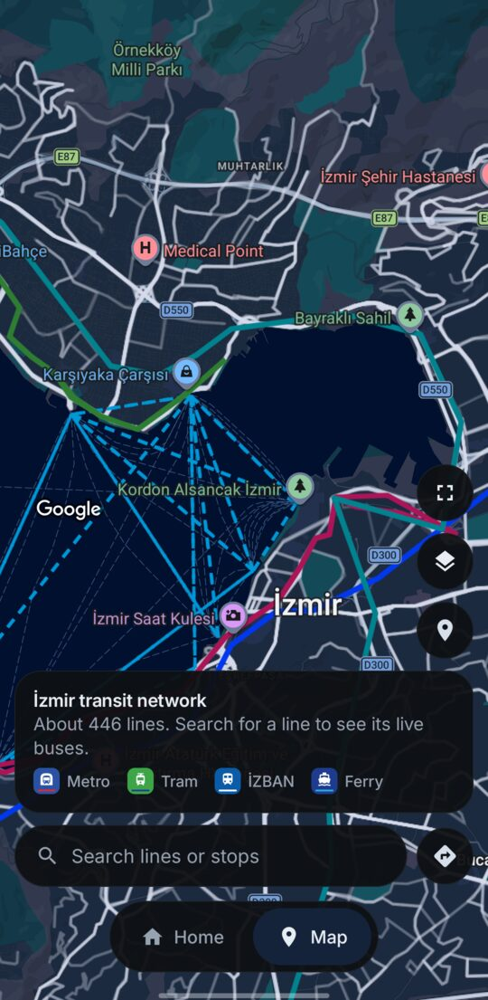
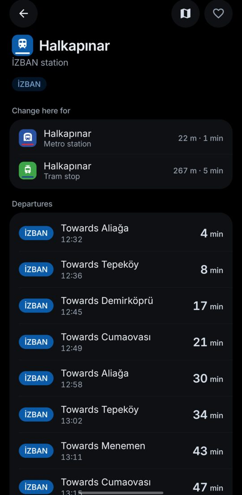
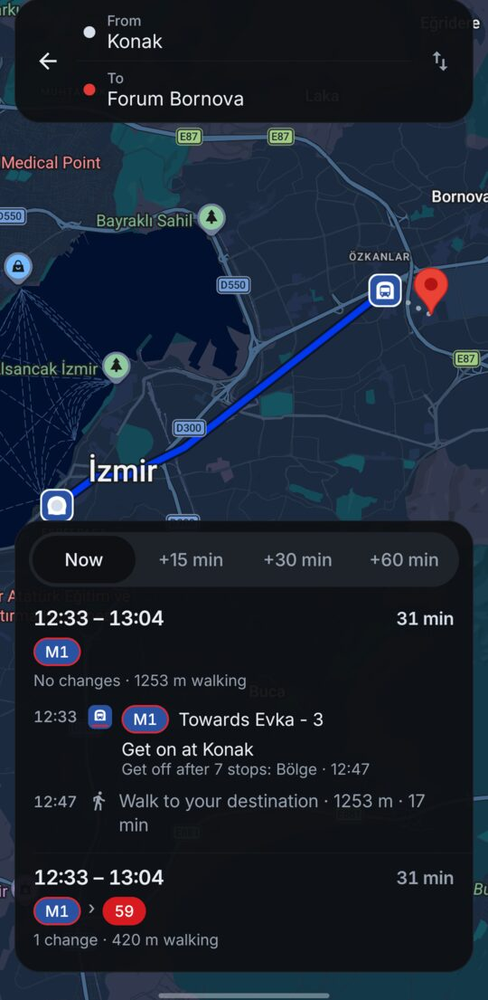
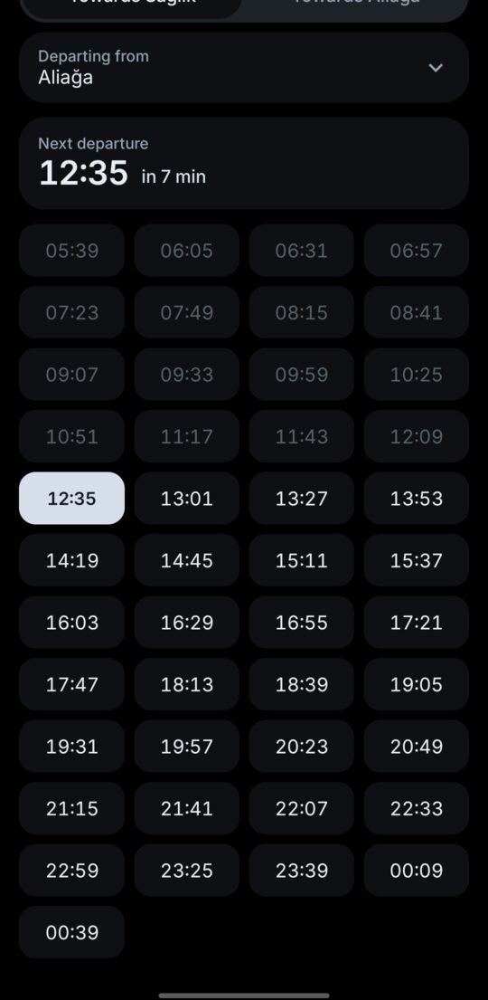

<p align="center">
  <picture>
    <source media="(prefers-color-scheme: dark)" srcset="docs/icons/icon-dark.svg">
    
  </picture>
</p>

# İzmir Transit

**All of İzmir's public transport in one fast, offline-first Android app** — ESHOT buses with live positions, Metro İzmir, Tram İzmir, İZBAN and İzdeniz ferries, timetables, interchanges and a trip planner.

*İzmir'in tüm toplu taşıması tek uygulamada: canlı ESHOT otobüsleri, metro, tramvay, İZBAN ve vapur; sefer saatleri, aktarmalar ve yol tarifi. İnternet olmadan da çalışır.*

[Website](https://aijeculate.github.io/izmir-transit/) · [Download the APK](https://github.com/aijeculate/izmir-transit/releases/latest/download/izmir-transit.apk) · [Privacy](PRIVACY.md)

| | | | |
|---|---|---|---|
|  |  |  |  |

## Features

- **Live buses** on the map, gliding between updates, for all 446 ESHOT lines.
- **Every stop and station**: ESHOT stops, Metro and İZBAN stations, tram stops and ferry piers. Zoom in to see them all; tap one for its lines and interchanges.
- **Arrivals** at bus stops (stops away and minutes), and **departure boards** at stations and piers, with the train that "just left" in case it's running late.
- **Timetables** for every line, with the next departure highlighted; for rail and ferries from any station. Metro and tram times follow the operators' current service plans; public holidays and bayrams use the holiday timetable.
- **Trip planner**: type an address, a place or a stop and get which stop to walk to, which bus or train to take and where to change. Leave now, leave at or arrive by a time; save home and work for one-tap trips. It runs entirely on the phone (multi-criteria RAPTOR: time, changes and walking).
- **Trip tracking**: start a planned trip and a notification tells you where to walk, how many stops are left and when to get off.
- **Interchanges** such as Hilal and Halkapınar (Metro ↔ İZBAN), Konak (Metro, tram, ferry).
- **Favourites** with live arrivals on the home screen (tap Edit to reorder or remove them, lines and stops in any order), home-screen widgets that each show a stop or station you choose, and an alert when your bus is a few stops away.
- **Update check**: once a day the app asks GitHub for the latest release and offers it; switch it off or check by hand in Settings.
- **Works offline**: lines, stops, routes and timetables ship inside the app and refresh weekly on Wi-Fi.
- **Turkish and English**, light / dark / AMOLED themes, a calm and a liquid-glass style.

## How it works

Everything except live bus positions is stored on the phone, so the app opens instantly and works with a bad connection.

| Data | Source |
| --- | --- |
| ESHOT lines, stops, routes, timetables, announcements | [İzmir open data portal](https://acikveri.bizizmir.com) (CSV) and ESHOT's GTFS feed |
| Live bus positions and arrivals | İzmir Teknoloji (İztek) open web services |
| Metro İzmir, Tram İzmir | The operators' GTFS feeds |
| İZBAN | The timetable published on [izban.com.tr](https://www.izban.com.tr/Sayfalar/SeferSaatleri.aspx?MenuId=24) (the GTFS feed is out of date) |
| İzdeniz ferries | İzdeniz open API |
| Map, place search | Google Maps SDK and Places API |

The trip planner is a [RAPTOR](https://www.microsoft.com/en-us/research/publication/round-based-public-transit-routing/) search over that offline network: rail and ferry times come from station timetables, bus times along a route are estimated from the departure at the first stop, and walking transfers of up to 400 m connect nearby stops. No routing service is called.

Arrival times are estimates; the app is not affiliated with ESHOT, Metro İzmir, Tram İzmir, İZBAN, İzdeniz or İzmir Metropolitan Municipality.

## Building

Requirements: JDK 21, the Android SDK (compileSdk 37), and a Google Maps API key.

1. **Google key.** In the Google Cloud console enable *Maps SDK for Android* and *Places API (New)*, create a key restricted to the package `com.aijec.izmirtransit` and your signing certificate's SHA-1, and add it to `local.properties`:

   ```properties
   MAPS_API_KEY=AIza...
   # Optional: a separate key for place search; falls back to MAPS_API_KEY.
   PLACES_API_KEY=AIza...
   ```

   Without a key the map stays blank; everything else works.

2. **Data.** The offline database is built from the public sources above. Download them once (about six minutes; İZBAN and İzdeniz are fetched politely, one request a second):

   ```bash
   ./gradlew :tools:importer:downloadData
   ```

3. **Build.** The app build creates the database from `research/raw` and bundles it:

   ```bash
   ./gradlew :app:assembleDebug
   ./gradlew test        # unit tests (no data or keys needed)
   ```

4. **Release.** Put your signing details in `keystore.properties` (git-ignored) and run `./gradlew :app:assembleRelease`:

   ```properties
   storeFile=release.jks
   storePassword=...
   keyAlias=...
   keyPassword=...
   ```

   Add the release certificate's SHA-1 to the Google key's Android restriction.

### Project layout

| Module | |
| --- | --- |
| `:core:model` | Domain types and geometry |
| `:core:database` | Room (KMP) schema and DAOs |
| `:core:data` | Importers, live API client, repositories, trip planner |
| `:core:ui` | Design system: theme, panels, badges, mode colours, glass |
| `:core:map` | The Google map with routes, stops and vehicles |
| `:core:location` | One-shot location |
| `:feature:*` | Home, map, stop, timetable, planner, settings |
| `:app` | Navigation, widget, alerts, background refresh |
| `:tools:importer` | Builds the offline database; data download and smoke tests |

## Licences

- Code: [GNU GPL v3](LICENSE).
- Transit data: İzmir Metropolitan Municipality Open Data Licence and the respective operators' published timetables.
- Font: Inter, SIL Open Font License 1.1 (`core/ui/licenses`).
- Map and place search: Google Maps Platform terms.
